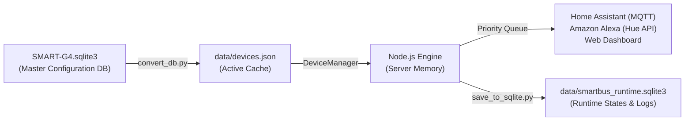

# SmartBus G4 & Z-Audio Home Automation
## Database Operator's Manual: Population, Structure & Search

This guide explains how the SmartBus G4 SQLite database works, how to add rooms and devices, how to edit channels, and how to search and verify your data.

---

### Database Architecture & Data Pipeline



<details>
<summary>📐 View Mermaid Diagram Source</summary>



</details>

The system uses two SQLite database files:
1. **`db/SMART-G4.sqlite3`** *(Master Configuration)*: Defines the rooms, lights, relays, fans, dimmers, curtains, AC units, and their hardware addresses (Subnet, Device, Channel).
2. **`data/smartbus_runtime.sqlite3`** *(Runtime State)*: Automatically maintains current live power states (ON/OFF), dimmer levels (0–100%), fan speeds, and timestamps.

---

## Part 1: Core Database Tables & Fields

You only need to know **three primary tables** to configure your entire home:

### 1. Table `Zones` (Rooms & Areas)
Defines the rooms and spaces in your house.

| Column | Type | Description | Example |
|---|---|---|---|
| **`ZoneID`** | INTEGER | Unique numeric room number | `3`, `4`, `5` |
| **`ZoneName`** | TEXT | Name of the room | `"Kitchen"`, `"Living Room"`, `"Parents Bedroom"` |

---

### 2. Table `LightInZone` (Lighting, Relays, Sockets & Dimmers)
Every single relay switch, spotlight, chandelier, plug socket, or geyser is stored here.

| Column | Type | Description | Example |
|---|---|---|---|
| **`ZoneID`** | INT | The Room ID this light belongs to (from `Zones`) | `3` (Kitchen) |
| **`LightID`** | INT | Light number inside this room | `1`, `2`, `3`... |
| **`LightRemark`**| VARCHAR | **Spoken name for Alexa & Home Assistant** | `"Spot 1"`, `"Geyser"`, `"Dry Area"` |
| **`SubnetID`** | INT | SmartBus Subnet ID (typically `1`) | `1` |
| **`DeviceID`** | INT | Hardware Module ID (e.g. 12-channel relay module) | `47` |
| **`ChannelNo`** | INT | Physical relay/dimmer output terminal (1–24) | `14` |
| **`CanDim`** | TINYINT| `1` for dimmable light; `0` for on/off relay switch | `0` (Relay), `1` (Dimmer) |
| **`status`** | VARCHAR | Initial boot state: `'0'` for OFF, `'1'` for ON | `'0'` |

> [!NOTE]
> When exposed to Alexa and Home Assistant, the system automatically combines `ZoneName` + `LightRemark` to form clean entity names like **"Kitchen Spot 1"** or **"Kitchen Geyser"**.

---

### 3. Table `FanInZone` (Ceiling & Exhaust Fans)
Stores fan regulators with speed step controls.

| Column | Type | Description | Example |
|---|---|---|---|
| **`ZoneID`** | INTEGER | Room ID where the fan is installed | `3` (Kitchen) |
| **`FanID`** | INTEGER | Unique Fan Number | `1` |
| **`FanName`** | VARCHAR | Name of the fan | `"Kitchen Fan"`, `"Master Fan"` |
| **`SubnetID`** | CHAR | SmartBus Subnet ID | `'1'` |
| **`DeviceID`** | CHAR | Fan Module Device ID | `'44'` |
| **`ChannelNO`** | CHAR | Fan Regulator Channel (1–4) | `'3'` |
| **`gear`** | VARCHAR | Total speed steps (typically 3 or 5) | `'5'` |
| **`currentSpeed`**| INTEGER | Current speed level: `0` (Off) to `5` (Turbo) | `0` |

---

## Part 2: Four Ways to Populate the Database

Choose whichever method is easiest for you:

---

### Method A: Use the Official SmartBus G4 Configuration Backup (Easiest)
If you already configured your home using the **Smart-G4 Windows software** or the **Android Smart-G4 tablet app**:
1. Locate the exported file `SMART-G4.sqlite3` (or `SMART-G4.db`).
2. Copy and replace it into the `db/` folder:
   ```
   d:\smartbusG4_HomeAutomation\db\SMART-G4.sqlite3
   ```
3. Restart the container:
   ```powershell
   docker compose restart smartbusg4-node
   ```
4. All your rooms, lights, and fans are imported automatically!

---

### Method B: Using Free GUI Tool "DB Browser for SQLite" (Visual & Beginner Friendly)
If you want to view and edit devices visually using a friendly desktop program:

1. Download and install **DB Browser for SQLite** (free & open source) from [sqlitebrowser.org](https://sqlitebrowser.org/).
2. Open DB Browser and click **"Open Database"**.
3. Select `d:\smartbusG4_HomeAutomation\db\SMART-G4.sqlite3`.
4. Go to the **"Browse Data"** tab:
   - Select the **`Zones`** table from the dropdown. Click **"New Record"** to add a new room (enter `ZoneID` e.g. `15` and `ZoneName` e.g. `"Balcony"`).
   - Select the **`LightInZone`** table. Click **"New Record"** to add a new switch:
     - `ZoneID`: `15`
     - `LightID`: `1`
     - `LightRemark`: `"Ceiling Spot"`
     - `SubnetID`: `1`
     - `DeviceID`: `47`
     - `ChannelNo`: `5`
     - `CanDim`: `0`
5. Click **"Write Changes"** (or press `Ctrl + S`) to save.
6. Restart the Docker container (`docker compose restart smartbusg4-node`) to apply changes.

---

### Method C: Using the Built-in Command-Line Tool (`scripts/manage_db.py`)
We built an interactive command-line helper for fast, error-free management without opening any database editors.

#### 1. Add a Room:
```bash
python scripts/manage_db.py add-room "Balcony"
```

#### 2. Add a Relay Switch (Light / Socket / Geyser):
```bash
python scripts/manage_db.py add-light --room "Balcony" --name "Wall Light" --subnet 1 --device 47 --channel 7
```

#### 3. Add a Dimmable Light:
```bash
python scripts/manage_db.py add-light --room "Living Room" --name "Chandelier" --subnet 1 --device 12 --channel 2 --dimmer
```

#### 4. Add a Fan:
```bash
python scripts/manage_db.py add-fan --room "Balcony" --name "Exhaust Fan" --subnet 1 --device 44 --channel 1
```

#### 5. List all configured rooms:
```bash
python scripts/manage_db.py list-rooms
```

#### 6. List all devices:
```bash
python scripts/manage_db.py list-devices
```
Or filter by room:
```bash
python scripts/manage_db.py list-devices --room "Kitchen"
```

---

### Method D: Using the Web Dashboard Subnet Scanner (Over the Network)
1. Open the Web Dashboard in your browser: `http://localhost:3000` (or `http://<pi-ip>:3000`).
2. Click on the **Subnet Scanner & Setup** tab in the sidebar.
3. Click **"Scan Subnet (Port 6000)"**.
4. The server broadcasts on the SmartBus network and discovers all physical DIN-rail modules (12-channel relays, dimmers, sensors, HVAC gateways).
5. You can view the firmware, module types, channel counts, and assign devices directly from the UI.

---

## Part 3: How to Search the Database

### Method 1: Instant Search in the Web Dashboard
1. Open `http://localhost:3000`.
2. **Lighting & Switches Tab**: Type any room or light name into the **Filter by room or device name...** search box. Matching devices filter in real time.
3. **Alexa Voice Control Tab**: Type into the **Filter devices...** search box in the *Exposed Devices Registry (Alexa Hue API)* table to search by Spoken Name, Hue ID (`1`–`87`), or type.

---

### Method 2: Terminal Search via `manage_db.py`
Run the search command with any keyword:

#### Search by Room Name:
```bash
python scripts/manage_db.py search "Kitchen"
```
**Output:**
```
===========================================================================
 Search Results for: 'Kitchen'
===========================================================================
 Type     | Room               | Name                   | Address    | Status
---------------------------------------------------------------------------
 Relay    | Kitchen            | Spot 1                 | 1.47.14    | ON
 Relay    | Kitchen            | Spot 2                 | 1.47.15    | ON
 Relay    | Kitchen            | Dry Area               | 1.47.21    | ON
 Relay    | Kitchen            | Socket 1               | 1.47.22    | OFF
 Relay    | Kitchen            | Dishwasher             | 1.47.23    | OFF
 Relay    | Kitchen            | Socket 2               | 1.47.24    | OFF
 Relay    | Kitchen            | Geyser                 | 1.5.5      | OFF
 Relay    | Kitchen            | Washing Machine        | 1.120.8    | OFF
 Fan      | Kitchen            | Fan                    | 1.44.3     | Speed 5
===========================================================================
 Total Matches: 9
```

#### Search by Device Type:
```bash
python scripts/manage_db.py search "Fan"
```

#### Search by Hardware Address (Subnet.Device.Channel):
```bash
python scripts/manage_db.py search "1.47"
```

---

### Method 3: Direct SQL Queries (For Advanced Users)
You can run standard SQL queries using DB Browser for SQLite or the `sqlite3` CLI tool:

#### Find all dimmable lights in the house:
```sql
SELECT Z.ZoneName, L.LightRemark, L.SubnetID, L.DeviceID, L.ChannelNo 
FROM LightInZone L
JOIN Zones Z ON L.ZoneID = Z.ZoneID
WHERE L.CanDim = 1;
```

#### Find which equipment is connected to hardware Module 47:
```sql
SELECT Z.ZoneName, L.LightRemark, L.ChannelNo 
FROM LightInZone L
JOIN Zones Z ON L.ZoneID = Z.ZoneID
WHERE L.DeviceID = 47
ORDER BY L.ChannelNo ASC;
```

#### Count total switches per room:
```sql
SELECT Z.ZoneName, COUNT(L.LightID) AS TotalSwitches
FROM Zones Z
LEFT JOIN LightInZone L ON Z.ZoneID = L.ZoneID
GROUP BY Z.ZoneName
ORDER BY TotalSwitches DESC;
```

---

## Part 4: Backing Up and Restoring Your Setup

To create a complete backup of your entire home configuration:
1. Copy the file `db/SMART-G4.sqlite3` and save it to a safe location (e.g. Google Drive, USB flash drive, or email it to yourself).
2. If you ever move to a new Raspberry Pi or reinstall Windows, simply copy `SMART-G4.sqlite3` back into the `db/` folder and run `docker compose up -d`. All 87+ devices, names, rooms, channels, and Alexa integrations will be restored instantly!
