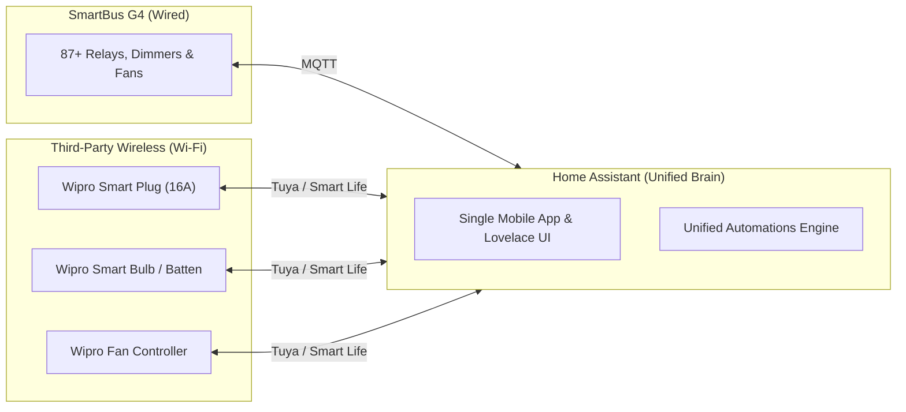

# SmartBus G4 & Home Assistant Integration
## Complete Step-by-Step Setup & Operator's Manual

This manual explains how to connect your **SmartBus G4 Home Automation & Z-Audio system** to **Home Assistant** using the integrated **MQTT Auto-Discovery Engine**. 

> [!NOTE]
> **Zero Manual YAML Required**: All 87+ SmartBus switches, dimmers, fans, air conditioners, and motorized curtains are discovered automatically with room names, device icons, and clean entity IDs.

---

### System Architecture

```mermaid
flowchart TD
    subgraph SmartBus_Hardware ["SmartBus G4 Wired Network"]
        Relays["DIN-Rail Relays (Module 47, 5, 120...)"]
        Dimmers["Phase Dimmers"]
        Fans["Fan Speed Regulators (Module 44)"]
        HVAC["Coolmaster / HVAC Gateways"]
        Curtains["Motorized Curtain Controllers"]
        ZAudio["Z-Audio RSIP Gateway"]
    end

    GW["SmartBus IP Gateway<br/>(192.168.0.200:6000 UDP)"]
    Relays <-->|S-Bus Data Cable| GW
    Dimmers <-->|S-Bus Data Cable| GW
    Fans <-->|S-Bus Data Cable| GW
    HVAC <-->|S-Bus Data Cable| GW
    Curtains <-->|S-Bus Data Cable| GW
    ZAudio <-->|UDP 6000| GW

    subgraph Server_Host ["SmartBus Automation Host (Pi 4 or PC)"]
        NodeEngine["SmartBus Engine (Node.js)<br/>• Priority Command Queue<br/>• Auto-Discovery Dispatcher<br/>• Real-time State Mirror"]
        MosqBroker["Mosquitto MQTT Broker<br/>(Port 1883 / WebSockets 9001)"]
    end

    GW <-->|UDP Binary Frames| NodeEngine
    NodeEngine <-->|MQTT Topics (smartbus/#)| MosqBroker
    NodeEngine -->|Auto-Discovery (homeassistant/#)| MosqBroker

    subgraph Home_Assistant ["Home Assistant (Any Device: Pi, VM, NUC, Cloud)"]
        HAMQTT["MQTT Integration"]
        HALovelace["Home Assistant UI (Lovelace)<br/>• Rooms & Suggested Areas<br/>• Mobile App (iOS / Android)<br/>• Unified Dashboards & Automations"]
        ThirdParty["Third-Party Integrations<br/>(Wipro, Tuya, Zigbee, Philips Hue)"]
    end

    MosqBroker <-->|MQTT 1883 TCP| HAMQTT
    HAMQTT <--> HALovelace
    ThirdParty <--> HALovelace
```

---

## Part 1: Connecting Home Assistant to SmartBus (Two Scenarios)

### Scenario A: Connect Home Assistant to the Built-in Mosquitto Broker (Recommended & Easiest)

Your SmartBus server already includes a pre-configured Mosquitto MQTT broker running on port `1883`.

#### Step 1: Find your SmartBus Server IP Address
- **On Raspberry Pi**: Run `hostname -I` in terminal (e.g. `192.168.0.205`).
- **On Windows 11**: Open PowerShell and run `ipconfig` (look for the Wi-Fi or Ethernet IPv4 address, e.g. `192.168.0.18`).
- Alternatively, check the top bar of your Web Dashboard (`http://<server-ip>:3000`).

#### Step 2: Add the MQTT Integration in Home Assistant
1. Open your Home Assistant dashboard in a browser (e.g. `http://homeassistant.local:8123` or `http://<ha-ip>:8123`).
2. In the left navigation menu, click **Settings** (⚙️).
3. Click **Devices & Services**.
4. In the bottom right corner, click the **+ Add Integration** button.
5. In the search box, type `MQTT` and select **MQTT**.

#### Step 3: Enter Connection Settings
Fill out the connection form:
- **Broker**: Enter your SmartBus Server IP *(e.g. `192.168.0.205` or `192.168.0.18`)*.
- **Port**: `1883`
- **Username**: *(Leave blank)*
- **Password**: *(Leave blank)*
- **Keep alive**: `60`
- Click **Submit**.

```
┌───────────────────────────────────────────────┐
│ Connect to MQTT Broker                        │
├───────────────────────────────────────────────┤
│ Broker:   [ 192.168.0.205                   ] │
│ Port:     [ 1883                            ] │
│ Username: [ (leave blank)                   ] │
│ Password: [ (leave blank)                   ] │
│                                               │
│                         [ CANCEL ] [ SUBMIT ] │
└───────────────────────────────────────────────┘
```

#### Step 4: Instant Auto-Discovery
Within 2 seconds, Home Assistant will pop up a success dialog confirming **87+ devices discovered**!
All your equipment will immediately appear under **Settings ➔ Devices & Services ➔ MQTT**.

---

### Scenario B: Connect SmartBus to your Existing Home Assistant Mosquitto Add-on

If you already run the official **Mosquitto Broker Add-on** inside Home Assistant:

1. Open the SmartBus Web Dashboard (`http://<smartbus-server-ip>:3000`).
2. Click on the **Queue & MQTT Service** tab in the sidebar.
3. Under **MQTT Broker Connection Settings**, configure:
   - **Broker URL**: `mqtt://<home-assistant-ip>:1883` *(e.g. `mqtt://192.168.0.100:1883`)*
   - **Username**: Your Home Assistant MQTT user username (created under *Settings ➔ People ➔ Users*).
   - **Password**: Your Home Assistant MQTT user password.
   - **Home Assistant Auto-Discovery**: Toggle **ON**.
4. Click **Connect & Save Settings**.
5. Click **Sync with Home Assistant Now**. All entities will broadcast directly into your existing broker.

---

## Part 2: Supported Entity Types & Controls

The SmartBus integration automatically assigns the correct Home Assistant entity type and icon based on your device names and hardware functions:

### 1. Lights & Dimmers (`light.*`)
- **Dimmable Lights**: Includes on/off toggle and full 0–100% brightness slider.
- **Relay Lights & Spotlights**: Words like `Spot`, `Light`, `Chandelier`, `Downlight`, `Ceiling`, or `Dry Area` are automatically recognized as lighting entities with lightbulb icons.
- **Color Accent Lights**: RGB dimmers display an interactive color wheel and brightness controls.

### 2. Appliances, Relays & Sockets (`switch.*`)
- **Electrical Sockets / Plugs**: Automatically assigned the `outlet` device class with wall plug icons.
- **Geysers / Water Heaters**: Automatically assigned the water boiler icon (`mdi:water-boiler`).
- **Washing Machines & Dishwashers**: Automatically assigned appliance icons (`mdi:washing-machine`).

### 3. Ceiling & Exhaust Fans (`fan.*`)
- Standard SmartBus fan regulators (1–5 speed steps) are mapped to Home Assistant `fan` entities.
- Supports smooth speed percentages:
  - **Speed 1**: 20% (Low)
  - **Speed 2**: 40% (Medium-Low)
  - **Speed 3**: 60% (Medium)
  - **Speed 4**: 80% (Medium-High)
  - **Speed 5**: 100% (Turbo / Maximum)

### 4. Motorized Curtains & Blinds (`cover.*`)
- Motorized curtains and roller shades expose **Open**, **Close**, **Stop**, and 0–100% position controls.

### 5. Air Conditioning & Thermostats (`climate.*`)
- Coolmaster / HVAC units expose:
  - **Target Temperature Slider** (16°C – 30°C)
  - **Current Ambient Room Temperature**
  - **Operating Modes**: `Cool`, `Heat`, `Fan Only`, `Dry`, `Off`
  - **Fan Speeds**: `Low`, `Medium`, `High`, `Auto`

### 6. Suggested Areas (Automatic Room Placement)
Each device is automatically linked to its room area (e.g. *Kitchen*, *Living Room*, *Parents Bedroom*, *Dining*, *Guest Bathroom*). When you open Home Assistant's **Areas & Zones**, your entire house is already neatly structured!

---

## Part 3: Integrating Third-Party Smart Devices (Wipro, Tuya, Smart Life)

A major advantage of using Home Assistant is uniting wired **SmartBus G4** hardware with wireless **Wipro** or **Tuya** smart devices under one single roof.



### How to Add Your Wipro Devices to Home Assistant:

Wipro Smart Home devices (plugs, bulbs, switches) are powered by the **Tuya / Smart Life** IoT platform.

#### Method 1: Official Tuya Cloud Integration (Recommended for Beginners)
1. In the **Wipro Next Smart Home App** (or **Smart Life App**), ensure your Wipro plugs and switches are paired and working on your Wi-Fi.
2. In Home Assistant, navigate to:
   **Settings** ➔ **Devices & Services** ➔ **+ Add Integration**.
3. Search for **Tuya** and click on it.
4. Scan the QR code using your **Smart Life App** (or enter your Tuya developer credentials).
5. All your Wipro devices appear in Home Assistant alongside your SmartBus devices!

#### Method 2: LocalTuya (For 100% Local Control without Internet)
1. Install **LocalTuya** from HACS (Home Assistant Community Store).
2. LocalTuya controls Wipro devices directly over your local Wi-Fi without cloud roundtrips.

---

## Part 4: Designing Your Home Assistant Dashboard

Once discovered, you can organize your dashboard by Room or by Device Type:

### Example 1: Room-Based Layout (Kitchen Area)
Add a **Vertical Stack** card with your SmartBus and Wipro devices side-by-side:

```yaml
type: vertical-stack
title: Kitchen
cards:
  - type: entities
    title: Lights & Appliances
    entities:
      - entity: light.kitchen_spot_1
        name: Spot 1
      - entity: light.kitchen_spot_2
        name: Spot 2
      - entity: switch.kitchen_geyser
        name: Geyser
      - entity: switch.kitchen_dishwasher
        name: Dishwasher
  - type: tile
    entity: fan.kitchen_fan
    name: Kitchen Ceiling Fan
  - type: tile
    entity: switch.wipro_smart_plug_16a
    name: Wipro Microwave Plug
```

### Example 2: Whole-Home Master Control
Add a grid card to control major zones:
```yaml
type: grid
columns: 2
square: false
cards:
  - type: tile
    entity: light.kitchen_spot_1
    name: Kitchen Spots
  - type: tile
    entity: fan.kitchen_fan
    name: Kitchen Fan
  - type: tile
    entity: cover.hall_main_curtain
    name: Hall Curtains
  - type: tile
    entity: climate.living_room_ac
    name: AC Thermostat
```

---

## Part 5: Practical Automations & Scenes

Home Assistant allows you to create powerful automations linking SmartBus G4 with sensors, schedules, and third-party devices:

### Automation 1: "Good Night" Master Off
Turn off all lights, TVs, and sockets in the house at 11:30 PM:
```yaml
alias: "Good Night - Master Off"
trigger:
  - platform: time
    at: "23:30:00"
action:
  - service: light.turn_off
    target:
      entity_id: all
  - service: switch.turn_off
    target:
      entity_id:
        - switch.kitchen_geyser
        - switch.wipro_smart_plug_16a
```

### Automation 2: Cross-System Motion Lighting
Turn on the SmartBus Kitchen light when a wireless motion sensor detects movement:
```yaml
alias: "Kitchen Night Motion Light"
trigger:
  - platform: state
    entity_id: binary_sensor.wipro_motion_sensor
    to: "on"
condition:
  - condition: time
    after: "20:00:00"
    before: "06:00:00"
action:
  - service: light.turn_on
    target:
      entity_id: light.kitchen_spot_1
    data:
      brightness_pct: 30
```

### Automation 3: Morning Wakeup Routine
Open curtains and start the geyser at 7:00 AM on weekdays:
```yaml
alias: "Morning Routine"
trigger:
  - platform: time
    at: "07:00:00"
condition:
  - condition: time
    weekday:
      - mon
      - tue
      - wed
      - thu
      - fri
action:
  - service: cover.open_cover
    target:
      entity_id: cover.hall_main_curtain
  - service: switch.turn_on
    target:
      entity_id: switch.kitchen_geyser
```

---

## Part 6: Troubleshooting & Common Questions

### Q1: Devices show as "Unavailable" in Home Assistant
1. Verify the SmartBus Docker container is running:
   ```bash
   docker compose ps
   ```
2. Verify MQTT broker connectivity:
   Open the Web Dashboard (`http://<server-ip>:3000`) and check the **Queue & MQTT Service** status indicator. It should show **Connected** (Green).
3. The server broadcasts a Last Will & Testament (LWT) topic `smartbus/status`. If the server goes offline, Home Assistant marks entities unavailable; when the server boots, it broadcasts `online` and all entities instantly restore.

### Q2: Device names look strange or retain old names
If you previously configured MQTT with old or corrupted names:
1. In Home Assistant: Go to **Settings ➔ Devices & Services ➔ MQTT**.
2. Click the three dots (⋮) on the MQTT integration and select **Reload**.
3. In the SmartBus Web Dashboard: Go to **Queue & MQTT Service** and click **Sync with Home Assistant Now**. This republishes fresh discovery configuration frames to `homeassistant/#`.

### Q3: Server IP changed due to router reboot (DHCP)
If your Raspberry Pi or Windows PC IP changes:
1. In Home Assistant: Go to **Settings ➔ Devices & Services ➔ MQTT**.
2. Click **Configure** ➔ **Re-configure MQTT**.
3. Update the **Broker** IP address to the new host IP.
4. Click **Submit**. All entities will reconnect immediately without losing any dashboards or automations!

---

## Summary Checklist

| Step | Action | Status |
| :--- | :--- | :--- |
| **1** | Note your SmartBus Host IP (`192.168.0.x`) | ✅ Ready |
| **2** | Add **MQTT** integration in Home Assistant Settings | ✅ Ready |
| **3** | Enter Broker IP and Port `1883` | ✅ Ready |
| **4** | Verify 87+ devices appear in Devices & Services | ✅ Verified |
| **5** | Add Wipro devices via Tuya / Smart Life integration | 💡 Optional |
| **6** | Build custom Lovelace room cards and automations | 🚀 Done |