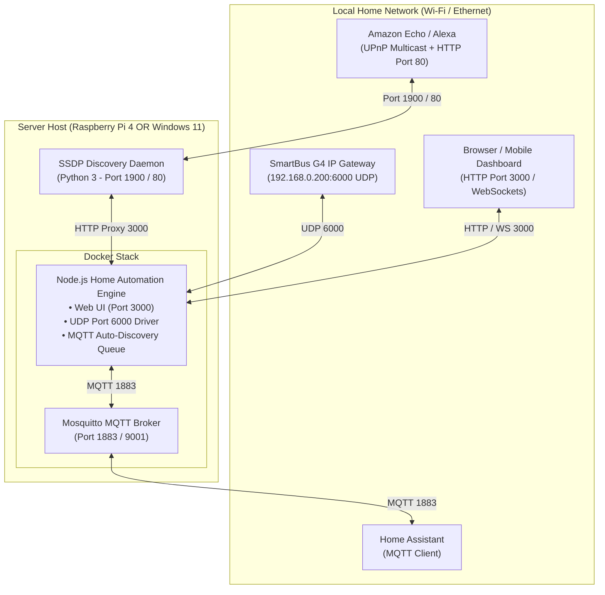

# SmartBus G4 & Z-Audio Home Automation
## Installation & Operator's Manual (Raspberry Pi 4 & Windows 11)

This guide walks you step-by-step through installing, running, and maintaining the SmartBus G4 Home Automation Server on both **Raspberry Pi 4** and **Windows 11** using Docker.

---

### System Architecture Overview



---

## Part 1: Installation on Raspberry Pi 4 (Docker)

The Raspberry Pi 4 is the recommended 24/7 dedicated server hardware.

### Prerequisites:
- Raspberry Pi 4 (2GB, 4GB, or 8GB RAM)
- MicroSD card with **Raspberry Pi OS (64-bit)** installed
- Raspberry Pi connected to your home Wi-Fi or Ethernet router
- SSH or Terminal access

---

### Step 1: Update System Packages
Open a terminal on your Raspberry Pi (or connect via SSH):
```bash
sudo apt update && sudo apt upgrade -y
sudo apt install -y git curl python3 python3-pip
```

---

### Step 2: Install Docker & Docker Compose
Run the official Docker convenience script:
```bash
curl -fsSL https://get.docker.com | sh
```
Add your current user (`pi`) to the `docker` group so you don't need `sudo` every time:
```bash
sudo usermod -aG docker $USER
```
> [!IMPORTANT]
> Log out and log back in (or run `newgrp docker`) for group permissions to take effect.

Verify Docker is working:
```bash
docker --version
docker compose version
```

---

### Step 3: Clone or Copy the Repository
Place the project on your Raspberry Pi (for example, in `/home/pi/smartbusG4_HomeAutomation`):
```bash
git clone <your-repo-url> ~/smartbusG4_HomeAutomation
cd ~/smartbusG4_HomeAutomation
```
*(Or transfer the folder from your PC using FileZilla / WinSCP).*

---

### Step 4: Configure Network Environment (`.env`)
The system features **zero hardcoded IP addresses** and auto-detects its LAN address:
1. Open the `.env` file:
   ```bash
   nano .env
   ```
2. Verify or update the gateway IP:
   ```env
   PORT=3000
   EXTERNAL_PORT=80
   ALEXA_PORT=80
   HOST_IP=auto
   UDP_PORT=6000
   GATEWAY_IP=192.168.0.200
   ZAUDIO_IP=192.168.0.200
   MQTT_BROKER_URL=mqtt://mqtt-broker:1883
   NODE_ENV=production
   ```
3. Press `Ctrl + O`, then `Enter` to save, and `Ctrl + X` to exit.

---

### Step 5: Start the Server Stack
Run the following command inside the project directory:
```bash
docker compose up -d --build
```
This builds the Node.js container, downloads Mosquitto MQTT, and boots the entire stack in the background.

Check that both containers are running healthy:
```bash
docker compose ps
```
You should see:
- `smartbusg4-mqtt-broker` (Up)
- `smartbusg4-node-app` (Up & healthy)

---

### Step 6: Enable Alexa SSDP Discovery Daemon on Raspberry Pi
Because modern Echo devices require local multicast discovery:
1. Test running the discovery responder:
   ```bash
   python3 scripts/alexa-ssdp-discovery.py
   ```
2. To have it start automatically on boot as a background service:
   Create a systemd service file:
   ```bash
   sudo nano /etc/systemd/system/alexa-ssdp.service
   ```
   Paste the following:
   ```ini
   [Unit]
   Description=SmartBus Alexa SSDP Discovery Daemon
   After=network.target docker.service

   [Service]
   Type=simple
   User=pi
   WorkingDirectory=/home/pi/smartbusG4_HomeAutomation
   ExecStart=/usr/bin/python3 scripts/alexa-ssdp-discovery.py
   Restart=always
   RestartSec=5

   [Install]
   WantedBy=multi-user.target
   ```
   Save and enable it:
   ```bash
   sudo systemctl daemon-reload
   sudo systemctl enable alexa-ssdp.service
   sudo systemctl start alexa-ssdp.service
   ```

---

### Step 7: Open the Dashboard
Open any web browser on your phone, tablet, or PC connected to the same Wi-Fi and visit:
```
http://<raspberry-pi-ip>:3000
```
*(e.g., `http://192.168.0.205:3000`)*.

---

## Part 2: Installation on Windows 11 (Docker Desktop)

Follow these steps if you want to run the server on a Windows 11 PC or laptop.

---

### Prerequisites:
1. **Windows 11** (64-bit Home, Pro, or Enterprise).
2. **Docker Desktop for Windows** (Download free from [docker.com](https://www.docker.com/products/docker-desktop/)).
   - During install, ensure **"Use WSL 2 instead of Hyper-V"** is checked.
3. **Python 3** (Download from [python.org](https://www.python.org/) or Anaconda).
   - Ensure you check **"Add Python to PATH"** during setup.

---

### Step 1: Start Docker Desktop
Launch Docker Desktop from the Start menu and verify the whale icon in your taskbar says "Docker Desktop is running".

---

### Step 2: Configure Windows Firewall
Windows 11 places home Wi-Fi networks in a **Private** network profile by default, which blocks incoming ports.
We created a 1-click script to configure Windows Firewall:
1. Open File Explorer to `d:\smartbusG4_HomeAutomation`.
2. Right-click [`fix-firewall.bat`](file:///d:/smartbusG4_HomeAutomation/fix-firewall.bat) and select **"Run as administrator"**.
3. Press any key when prompted. All necessary ports (`80`, `3000`, `1883`, `6000`, `1900`) are now allowed.

---

### Step 3: Launch Docker Stack
Open PowerShell inside `d:\smartbusG4_HomeAutomation` and run:
```powershell
docker compose up -d --build
```
Verify the containers are healthy:
```powershell
docker compose ps
```

---

### Step 4: Run the Alexa SSDP Discovery Daemon
On Windows, run the automated launcher:
```powershell
.\start-alexa-ssdp.bat
```
*(Or double-click `start-alexa-ssdp.bat` in File Explorer).*

> [!TIP]
> **Auto-Start on Windows Boot**: Press `Win + R`, type `shell:startup`, and press Enter. Create a shortcut to `start-alexa-ssdp.bat` inside that Startup folder. It will launch automatically every time you log in to Windows!

---

### Step 5: Open the Dashboard
Open your browser (Edge, Chrome, Brave) and visit:
```
http://localhost:3000
```
Or from your phone/tablet: `http://<your-pc-ip>:3000` *(e.g., `http://192.168.0.18:3000`)*.

---

## Part 3: Connecting to Home Assistant

Your SmartBus server includes an integrated **Priority Command Queue** and **Home Assistant MQTT Auto-Discovery Engine**.

1. In Home Assistant, navigate to:
   **Settings** ➔ **Devices & Services** ➔ **+ Add Integration**.
2. Search for **MQTT** and click on it.
3. Enter your connection settings:
   - **Broker**: `<server-ip>` *(e.g. your Raspberry Pi IP `192.168.0.205` or Windows PC IP `192.168.0.18`)*
   - **Port**: `1883`
   - **Username / Password**: *(Leave blank — anonymous authentication is enabled by default)*
4. Click **Submit**.
5. Home Assistant will instantly discover all **87+ SmartBus devices** with clean names (e.g., `Kitchen Spot 1`, `Kitchen Fan`, `Hall Main Curtain`, `Parents Bedroom Wall Light`) and automatic room areas.

---

## Part 4: Connecting to Amazon Alexa (Voice Control)

1. Ensure the SSDP discovery daemon (`start-alexa-ssdp.bat` or systemd service) is running.
2. Say to your Amazon Echo:
   > **"Alexa, discover devices"**
   *(or open the Amazon Alexa App on your phone ➔ **Devices** ➔ **+** ➔ **Add Device** ➔ **Philips Hue** ➔ **V1 Bridge (Round shape)** ➔ **Scan**)*.
3. Alexa will discover all 87 equipment switches, fans, and dimmers without requiring any external cloud skill.
4. You can immediately say:
   - *"Alexa, turn on Kitchen Spot 1"*
   - *"Alexa, set Kitchen Spot 1 to 50%"*
   - *"Alexa, turn off Kitchen Fan"*

---

## Part 5: Common Operational Commands Quick Reference

| Action | Raspberry Pi Command | Windows 11 (PowerShell) |
|---|---|---|
| **Start stack** | `docker compose up -d` | `docker compose up -d` |
| **Stop stack** | `docker compose down` | `docker compose down` |
| **Restart server** | `docker compose restart smartbusg4-node` | `docker compose restart smartbusg4-node` |
| **Rebuild server** | `docker compose up -d --build smartbusg4-node` | `docker compose up -d --build smartbusg4-node` |
| **View live logs** | `docker compose logs -f smartbusg4-node` | `docker compose logs -f smartbusg4-node` |
| **View MQTT logs** | `docker compose logs -f mqtt-broker` | `docker compose logs -f mqtt-broker` |
| **Check database**| `python3 scripts/manage_db.py list-devices` | `python scripts\manage_db.py list-devices` |
| **Search devices**| `python3 scripts/manage_db.py search "Kitchen"`| `python scripts\manage_db.py search "Kitchen"` |
